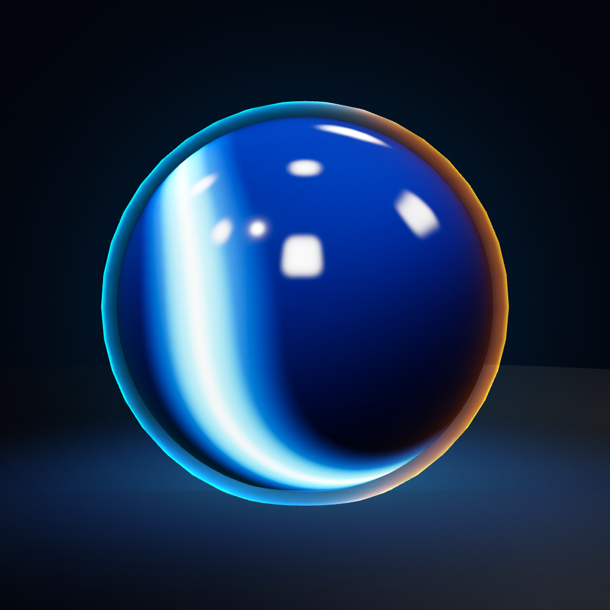

# The Cnmbuck Orb

Cnmbuck Studios' signature ball. It appears in every Cnmbuck game, looks the same everywhere, and is always
something special: won by mastering the game, or included with the game's supporter purchase. It is never
the free starting ball and never sold on its own.



## What's here

| File | Use |
|---|---|
| `cnmbuck-orb.ts` | Everything in code (needs three.js only). `createOrbMaterial()` for a 3D ball, `OrbFx` for its glow and light trail, `drawOrbIcon()` to draw it flat on a 2D canvas. Copy the file into a game as is. |
| `png/orb-1024.png`, `orb-512`, `orb-256`, `orb-128` | Flat Orb with its neon halo, transparent background: menus, shop cards, store art, 2D games. |
| `png/orb-plain-1024.png`, `orb-plain-256` | The same without the halo, for light backgrounds and small sizes. |
| `png/orb-3d-1024.png` | The 3D ball rendered on a dark stage: press kits, social posts, the studio website. |

## The look

- **Glass:** deep blue, darkest at the bottom (`#020818`) and lit from above (`#0c3486`), with a high clearcoat.
- **Neon band:** a tilted ring with a gentle ripple, never a letter S. Neon cyan `#00e5ff`, a soft outer glow
  `#0a8cff` and a white-hot core `#f0feff`. It glows and pulses gently.
- **Rim light:** blue `#00d8ff` on the left edge, orange `#ff9a1a` on the right, as in the studio logo. In 3D
  it stays put while the ball rolls underneath it.
- **Halo:** a soft cyan glow around the ball.
- **Light trail:** cyan fading to orange behind the ball while it moves.
- **Ground glow (3D, optional):** a soft blue pool of light beneath it.

## How to get it in a game

Each game decides the details, but the rule is the same: the Orb is earned, not bought separately.

- **Earned** by a real accomplishment that every committed player can reach, such as finishing the expert
  course or the whole campaign.
- **Included** with the game's supporter purchase (Remove ads or similar), if the game has one.
- **Shown off:** its own "Signature ball" card at the top of the ball list, with a blue-to-orange border.
  The line used in Rack & Roll: *The Cnmbuck Studios ball. Glows, trails light and rolls in every Cnmbuck game.*

| Game | How it's won |
|---|---|
| Rack & Roll | Finish a round of Jolly Roger (the expert course), or buy Remove ads |
| Gravity Shift | Finish the campaign |
| Chain Reaction | Solve every level |

## Using the code

3D (three.js):

```ts
import { createOrbMaterial, OrbFx } from './cnmbuck-orb';

const ball = new THREE.Mesh(new THREE.SphereGeometry(radius, 48, 32), createOrbMaterial());
const fx = new OrbFx(radius);            // { groundGlow: false } if "down" isn't always -Y
scene.add(ball, fx.group);
fx.on = true;                            // only while the Orb is the ball in play
// every frame:
fx.update(ball.position, groundY, moving, ball.visible, dt, camera, renderer);
```

A bloom pass makes the band glow properly, but it looks right without one.

2D (canvas, or a PixiJS texture made from a canvas):

```ts
import { drawOrbIcon } from './cnmbuck-orb';
drawOrbIcon(ctx, size, x, y, spin);      // spin turns the band, for a rolling ball
```

Source of truth: `cnmbuck1/poolgolf`, folder `brand/cnmbuck-orb/`. Change the Orb here first, then copy the
file to the games, so it never drifts apart.
